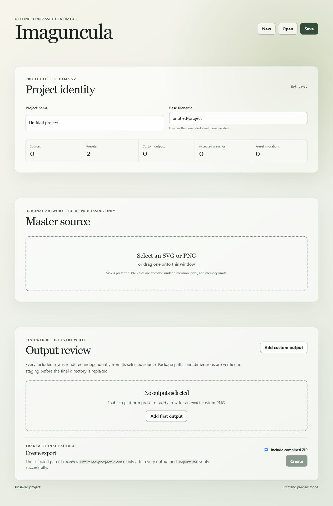

# Imaguncula


[](https://www.bestpractices.dev/projects/17106) [](https://www.bestpractices.dev/projects/17106)

Imaguncula is an offline desktop application and CLI that turns one high-quality SVG or PNG into correctly sized, named, and packaged icon assets for application platforms.

It exports Windows ICO files and MSIX resource families, Web/PWA icons and manifests, Linux hicolor trees, Xcode AppIcon catalogs, ICNS files, Icon Composer source packages, Android legacy, adaptive, and themed resources, and custom PNG sizes. The desktop application and the CLI use the same exporter. Each export writes a report and can also produce a combined ZIP. Saved projects pin the preset versions they were created with and only move to newer presets when you accept the change.

Imaguncula is in public beta. Download the desktop application and CLI from [GitHub Releases](https://github.com/HusteDev/imaguncula/releases). The downloads are not yet code-signed, so Windows SmartScreen and macOS Gatekeeper will warn about them; [docs/distribution.md](docs/distribution.md) explains how to verify them. The CLI is not yet on crates.io.



## Product invariants

- Render every output size directly from the original source.
- Never silently upscale raster artwork.
- Keep image processing local.
- Explain every output's dimensions, purpose, filename, and package destination.
- Keep platform presets data-driven and versioned.

See [PLAN.md](PLAN.md) for the product requirements, [EXECUTION-PLAN.md](EXECUTION-PLAN.md) for the implementation plan, [ROADMAP.md](ROADMAP.md) for what is planned next, and [GOVERNANCE.md](GOVERNANCE.md) for how the project is run.

## Use

See the [user guide](docs/user-guide.md) or open one of the three checked-in [example projects](examples/README.md). The CLI is documented in [docs/cli.md](docs/cli.md), with a [command reference](docs/cli-reference.md) generated from its help text.

## Development

From a clean checkout, run the bootstrap for the host operating system.

Windows PowerShell:

```powershell
powershell -ExecutionPolicy Bypass -File .\scripts\bootstrap.ps1
```

macOS or Debian/Ubuntu:

```bash
bash ./scripts/bootstrap.sh
```

The scripts list each tool before installing it, install only the pinned tools and native prerequisites that are missing, and then run the doctor, which checks the environment. Use `--dry-run` to see what would be installed, or `--yes` to install without prompts. After a first-time install, open a new shell so PATH changes take effect. To check an existing environment, run `scripts/doctor.ps1`, `scripts/doctor.sh`, or:

```powershell
just doctor
```

Start the application after the doctor passes:

```powershell
just run
```

CI runs the same commands as the `justfile`. Run `just ci` before submitting a change.

The `.devcontainer` definition gives Codespaces and Dev Containers the pinned Node.js and Rust toolchains and the Linux Tauri build dependencies, and runs the doctor after it is created. It works for building and testing; to run the desktop application itself you need a native checkout with a display.

## Architecture

- `crates/imaguncula-core`: pure processing logic; no Tauri or UI dependencies.
- `crates/imaguncula-presets`: versioned preset data and schema support.
- `crates/imaguncula-cli`: installable headless interface over the core.
- `src-tauri`: thin desktop IPC adapter.
- `src`: Svelte interface.

The [docs](docs) directory covers each export format, the project file and preset formats, security limits and the [assurance case](docs/assurance-case.md), and how releases are built and verified. [docs/architecture.md](docs/architecture.md) is the place to start.

## License

Licensed under either the Apache License, Version 2.0 or the MIT License, at your option.
